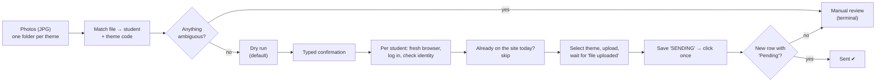

# failsafe-essay-uploader

**Bulk-uploads photos of handwritten essays to each student's account. When in doubt, it doesn't send.**


> **Unofficial personal project.** Built for my own work with the
> [Esquema Redação](https://www.esquemaredacao.com.br) essay-correction platform, with the
> school's permission. It is published as a **portfolio piece**, not as a tool for others to
> reuse: it is tied to that one site, and there is no license (all rights reserved).
> No student data, credentials or real essays are in this repository.

---

## The problem

Students write their essays by hand. Someone photographs every page and has to upload
each photo **into that student's own account** on the platform, picking the right essay
theme every time. With dozens of students a week, that is hours of repetitive clicking,
and a single mistake (wrong student, wrong theme, duplicate upload) costs a student a
paid correction credit.

## What it does



1. Reads a folder tree (`<theme>/<student name>.jpg`) and a student list.
2. Matches each photo to a student (accent-, case- and typo-tolerant, with human approval
   for anything that is not an exact match) and each folder to a theme code from the site.
3. Shows a full dry run of what would be sent. Nothing leaves the machine without
   `--envio-real` **and** a typed confirmation.
4. For each student: opens a clean browser context, logs in, verifies the account belongs to
   the right person, checks what is already on the site, uploads, and confirms that the
   platform registered the essay as "Pending".

## Safety-first design

Every step assumes that the site, the files or the network can lie. The rule is
**fail closed**: if the script cannot prove that a step is right, it stops before clicking.

| Risk | How it is handled |
|---|---|
| Sending by accident | Dry run is the default. Real sending needs a flag **and** a typed word (`ENVIAR`). The production path has a hard lock in the code. |
| Double upload (costs a credit) | The state `SENDING` is written to SQLite **before** the click. Anything uncertain after the click becomes *manual review* and is never retried automatically. |
| Same essay twice | Same day + same theme already on the site → skip. The same photo (sha256) is never sent twice, even under another file name. |
| Wrong student | A fresh browser per student, an identity check after login, and logout in `finally`. A test-account e-mail equal to a student's is refused. |
| Wrong theme | The theme is selected by the exact code text and the selected option is re-read. A duplicated code in the site's list is an error. |
| Site changes or errors | The essay list is accepted only with the expected header and page. HTTP errors, pagination or an unreadable list stop that student. A CAPTCHA stops the whole run. |
| Two runs at once | A lock file allows one sending run at a time. |
| Day boundary | Brasília time. Nothing is sent between 23:55 and 00:05, so "today" never flips mid-run. |
| Losing progress | The SQLite ledger is backed up before every run. If the backup fails, nothing is sent. |
| Secrets in logs | Passwords live only in `.env`. The log filter masks their **values**. |

## Features

- Interactive terminal menu (`python main.py`) on top of explicit CLI flags.
- Terminal review of themes and names, with renames logged and undoable.
- **Rehearsal mode**: real, already-checked essays sent to a *test account* only.
- **Site check** (read only): which photos are already on the site, on any date.
- Live progress bar, clickable file links in the terminal, and an end-of-run
  "what needs you" summary.
- A manual-review queue resolved with yes/no questions, never automatically.

## Tech

Python · Playwright (Chromium) · SQLite · pytest · RapidFuzz · BeautifulSoup · openpyxl

```
main.py                CLI (orchestration only)
modulos/base/          config, states, errors, SQLite ledger, clock, lock, terminal UI
modulos/dados/         student list, files, matching, approvals
modulos/site/          login, essay list, upload form, confirmation, read-only checks
modulos/envio/         queues and sending flows (test, rehearsal, production)
modulos/ferramentas/   menu, review, resolver, first-run setup, archive
tests/                 415 offline tests + a few real-browser tests (marked "real")
```

About 5.3k lines of application code and 7k lines of tests. Selectors were confirmed
against the real site and recorded with their source (see [`AGENTS.md`](AGENTS.md)).
Refuted guesses are kept on a "never reintroduce" list.

## Running the tests

```bash
pip install -r requirements.txt
python -m pytest -m "not real" -q
```

The offline suite needs no network or account. It includes a static check (pyflakes) of
the whole codebase, and tests run against a temporary project root, so they never touch
real data. The tests marked `real` drive a browser against a test account and are skipped
without local credentials and test photos.

## How it was built

It was developed over three weeks in small, numbered tasks (T1–T57, visible in the commit
history), with **AI pair-programming** (Cline and Claude Code) working under strict written
rules: real proof (test output pasted) before anything is called done, no guessed selectors,
and no AI ever sending to a real student account. [`AGENTS.md`](AGENTS.md) and
[`PROJECT_MEMORY.md`](PROJECT_MEMORY.md) are those rules and the project's memory.
`docs/` holds the task log, open questions and QA issues.

---

## Em português

Automação **não oficial** que envia as fotos das redações escritas à mão para a conta de
cada aluno na plataforma Esquema Redação, com o tema certo, e confere se a plataforma
recebeu. Foi feita para o meu uso, com permissão da instituição, e está aqui como
**portfólio**. Ela não serve para outros sites e não tem licença de uso.

O foco é a segurança: simulação por padrão, confirmação digitada, nunca reenvia sozinha,
detecta redação duplicada e para na dúvida. O manual de uso completo (em português) está em
[`docs/GUIA_DE_USO.md`](docs/GUIA_DE_USO.md).
