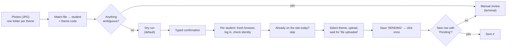
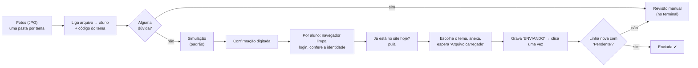

<a id="top"></a>

# failsafe-essay-uploader

<p align="center">
  <a href="#en"></a>
  &nbsp;
  <a href="#pt-br"></a>
</p>

<p align="center">
  
  
  
  
</p>

---

<a id="en"></a>

## 🇺🇸 English

**Bulk-uploads photos of handwritten essays to each student's account. When in doubt, it doesn't send.**

> **Unofficial personal project.** Built for my own work with the
> [Esquema Redação](https://www.esquemaredacao.com.br) essay-correction platform, with the
> school's permission. It is published as a **portfolio piece**, not as a tool for others to
> reuse: it is tied to that one site, and there is no license (all rights reserved).
> No student data, credentials or real essays are in this repository.

### The problem

Students write their essays by hand. Someone photographs every page and has to upload
each photo **into that student's own account** on the platform, picking the right essay
theme every time. With dozens of students a week, that is hours of repetitive clicking,
and a single mistake (wrong student, wrong theme, duplicate upload) costs a student a
paid correction credit.

### What it does



1. Reads a folder tree (`<theme>/<student name>.jpg`) and a student list.
2. Matches each photo to a student (accent-, case- and typo-tolerant, with human approval
   for anything that is not an exact match) and each folder to a theme code from the site.
3. Shows a full dry run of what would be sent. Nothing leaves the machine without
   `--envio-real` **and** a typed confirmation.
4. For each student: opens a clean browser context, logs in, verifies the account belongs to
   the right person, checks what is already on the site, uploads, and confirms that the
   platform registered the essay as "Pending".

### Safety-first design

Every step assumes that the site, the files or the network can lie. The rule is
**fail closed**: if the script cannot prove that a step is right, it stops before clicking.

| Risk | How it is handled |
|---|---|
| Sending by accident | Dry run is the default. Real sending needs a flag **and** a typed word (`ENVIAR`). The production path has a hard lock in the code. |
| Double upload (costs a credit) | The state `SENDING` is written to SQLite **before** the click. Anything uncertain after the click becomes *manual review* and is never retried automatically. |
| Same essay twice | Same day + same theme already on the site → skip. The same photo (sha256) is never sent twice, even under another file name. |
| Wrong student | A fresh browser per student, an identity check after login, and logout in `finally`. A test-account e-mail equal to a student's is refused. |
| Wrong theme | The theme is selected by the exact code text and the selected option is re-read. A duplicated code in the site's list is an error. |
| Site changes or errors | The essay list is accepted only with the expected header and page. HTTP errors, pagination or an unreadable list stop that student. A CAPTCHA stops the whole run. |
| Two runs at once | A lock file allows one sending run at a time. |
| Day boundary | Brasília time. Nothing is sent between 23:55 and 00:05, so "today" never flips mid-run. |
| Losing progress | The SQLite ledger is backed up before every run. If the backup fails, nothing is sent. |
| Secrets in logs | Passwords live only in `.env`. The log filter masks their **values**. |

### Features

- Interactive terminal menu (`python main.py`) on top of explicit CLI flags.
- Terminal review of themes and names: approved folders take the platform's theme name, files
  take the student's exact name; every rename is logged and undoable.
- After a read-only check on the site, folders whose every essay is already there can be marked
  `ENVIADA - ...`: the script ignores them from then on and offers them first for archiving.
- **Rehearsal mode**: real, already-checked essays sent to a *test account* only.
- **Site check** (read only): which photos are already on the site, on any date.
- Live progress bar, clickable file links in the terminal, and an end-of-run
  "what needs you" summary.
- A manual-review queue resolved with yes/no questions, never automatically.

### Tech

Python · Playwright (Chromium) · SQLite · pytest · RapidFuzz · BeautifulSoup · openpyxl

```
main.py                CLI (orchestration only)
modulos/base/          config, states, errors, SQLite ledger, clock, lock, terminal UI
modulos/dados/         student list, files, matching, approvals
modulos/site/          login, essay list, upload form, confirmation, read-only checks
modulos/envio/         queues and sending flows (test, rehearsal, production)
modulos/ferramentas/   menu, review, resolver, first-run setup, archive
tests/                 415 offline tests + a few real-browser tests (marked "real")
```

About 5.3k lines of application code and 7k lines of tests. Selectors were confirmed
against the real site and recorded with their source.
Refuted guesses are kept on a "never reintroduce" list.

### Running the tests

```bash
pip install -r requirements.txt
python -m pytest -m "not real" -q
```

The offline suite needs no network or account. It includes a static check (pyflakes) of
the whole codebase, and tests run against a temporary project root, so they never touch
real data. The tests marked `real` drive a browser against a test account and are skipped
without local credentials and test photos.

### How it was built

It was developed over three weeks in small, numbered tasks (T1–T57, visible in the commit
history), with **AI pair-programming** (Cline and Claude Code) working under strict written
rules: real proof (test output pasted) before anything is called done, no guessed selectors,
and no AI ever sending to a real student account.
[`docs/`](docs) holds the user guide ([`GUIA_DE_USO.md`](docs/GUIA_DE_USO.md), in Portuguese)
and every bug found, in [`docs/qa-issues/`](docs/qa-issues), each also tracked as a GitHub issue;
the task log is the commit history. Before every push,
`python -m modulos.ferramentas.auditoria_publica` checks that no student data, secret or AI
note is about to be published. Changes go through a branch and a reviewed pull request; user-facing
changes are listed in [`CHANGELOG.md`](CHANGELOG.md).

<p align="right"><a href="#top">⬆ back to top</a> · <a href="#pt-br">🇧🇷 Português</a></p>

---

<a id="pt-br"></a>

## 🇧🇷 Português

**Envia as fotos das redações escritas à mão para a conta de cada aluno. Na dúvida, não envia.**

> **Projeto pessoal, não oficial.** Feito para o meu trabalho com a plataforma de correção
> [Esquema Redação](https://www.esquemaredacao.com.br), com permissão da instituição. Está
> publicado como **portfólio**, e não como ferramenta para outros usarem: ele só funciona
> naquele site e não tem licença de uso (todos os direitos reservados). Este repositório não
> tem nenhum dado de aluno, senha nem redação real.

### O problema

Os alunos escrevem as redações à mão. Alguém fotografa cada folha e precisa enviar cada foto
**para a conta daquele aluno** na plataforma, escolhendo o tema certo toda vez. Com dezenas
de alunos por semana, são horas de cliques repetidos. Qualquer erro (aluno errado, tema
errado, envio duplicado) gasta um crédito de correção pago do aluno.

### O que ele faz



1. Lê as pastas (`<tema>/<nome do aluno>.jpg`) e a lista de alunos.
2. Liga cada foto a um aluno (aceita diferença de acento, maiúscula e erro de digitação, mas
   pede aprovação de uma pessoa para o que não for exato) e cada pasta a um código de tema do site.
3. Mostra uma simulação completa do que seria enviado. Nada sai do computador sem
   `--envio-real` **e** uma confirmação digitada.
4. Para cada aluno: abre um navegador limpo, faz login, confere se a conta é da pessoa certa,
   olha o que já está no site, envia e confirma que a plataforma registrou a redação como "Pendente".

### Segurança em primeiro lugar

Cada passo parte do princípio de que o site, os arquivos ou a rede podem enganar. A regra é
**falhar fechado**: se o script não consegue provar que um passo está certo, ele para antes de clicar.

| Risco | Como é tratado |
|---|---|
| Enviar sem querer | A simulação é o padrão. Para enviar de verdade é preciso uma opção **e** uma palavra digitada (`ENVIAR`). O envio para alunos tem uma trava no próprio código. |
| Envio duplicado (gasta crédito) | O estado `ENVIANDO` é gravado no SQLite **antes** do clique. Qualquer dúvida depois do clique vira *revisão manual* e nunca é reenviada sozinha. |
| Mesma redação duas vezes | Mesmo dia + mesmo tema já no site → pula. A mesma foto (sha256) nunca vai duas vezes, nem com outro nome de arquivo. |
| Aluno errado | Um navegador limpo por aluno, conferência da identidade depois do login e logout no `finally`. Se o e-mail da conta de teste for igual ao de um aluno, o script recusa. |
| Tema errado | O tema é escolhido pelo texto exato do código, e a opção marcada é lida de novo. Código repetido na lista do site é erro. |
| Site mudou ou deu erro | A lista de redações só vale com o cabeçalho e a página esperados. Erro HTTP, paginação ou lista ilegível param aquele aluno. CAPTCHA para a execução inteira. |
| Duas execuções ao mesmo tempo | Uma trava deixa só um envio por vez. |
| Virada do dia | Horário de Brasília. Nada é enviado entre 23:55 e 00:05, para o "hoje" não mudar no meio. |
| Perder o progresso | O caderno (SQLite) é copiado antes de cada envio. Se a cópia falhar, nada é enviado. |
| Senha no log | As senhas ficam só no `.env`. O filtro do log esconde o **valor** delas. |

### Recursos

- Menu no terminal (`python main.py`), além das opções de linha de comando.
- Revisão dos temas e dos nomes no terminal: a pasta aprovada ganha o nome do tema da plataforma e
  o arquivo, o nome exato do aluno; cada renomeação é registrada e reversível.
- Depois da conferência no site (só leitura), a pasta com todas as redações já lá pode ser marcada
  `ENVIADA - ...`: o script passa a ignorá-la e oferece guardá-la primeiro no arquivo morto.
- **Ensaio**: redações reais, já conferidas, enviadas só para uma *conta de teste*.
- **Conferir no site** (só leitura): quais fotos já estão no site, em qualquer data.
- Progresso ao vivo, nomes de arquivo clicáveis no terminal e, no fim, um resumo do
  "que precisa de você".
- Fila de revisão manual resolvida com perguntas de sim/não, nunca sozinha.

### Tecnologias

Python · Playwright (Chromium) · SQLite · pytest · RapidFuzz · BeautifulSoup · openpyxl

```
main.py                linha de comando (só orquestra)
modulos/base/          configuração, estados, erros, caderno SQLite, relógio, trava, visual do terminal
modulos/dados/         lista de alunos, arquivos, conciliação, aprovações
modulos/site/          login, lista de redações, formulário, confirmação, conferência
modulos/envio/         filas e fluxos de envio (teste, ensaio e produção)
modulos/ferramentas/   menu, revisão, resolver, primeiro uso, arquivo morto
tests/                 415 testes offline + alguns testes com navegador (marcados "real")
```

São cerca de 5,3 mil linhas de código e 7 mil linhas de testes. Os seletores do site foram
conferidos no site real e anotados com a fonte. Os palpites
que se mostraram errados ficam numa lista de "nunca reintroduzir".

### Rodando os testes

```bash
pip install -r requirements.txt
python -m pytest -m "not real" -q
```

Os testes offline não precisam de internet nem de conta. Eles incluem uma checagem
estática (pyflakes) do código todo e rodam numa pasta temporária, então nunca mexem em dados
reais. Os testes marcados `real` usam o navegador numa conta de teste e são pulados sem as
senhas e as fotos de teste locais.

### Como foi feito

Foi desenvolvido em três semanas, em tarefas pequenas e numeradas (T1–T57, que aparecem no
histórico de commits), com **programação em par com IA** (Cline e Claude Code) seguindo regras
escritas e rígidas: só se dá algo por feito com prova real (saída dos testes colada), nenhum
seletor é chutado e nenhuma IA envia nada na conta de um aluno de verdade. Em [`docs/`](docs) ficam o guia de uso ([`GUIA_DE_USO.md`](docs/GUIA_DE_USO.md)) e
todos os bugs encontrados, em [`docs/qa-issues/`](docs/qa-issues), cada um também como issue no GitHub;
o registro das tarefas é o histórico de commits. Antes de todo push,
`python -m modulos.ferramentas.auditoria_publica` confere que não vai dado de aluno, senha nem
anotação de IA. Cada mudança passa por uma branch e um pull request revisado; o que muda para quem
usa fica em [`CHANGELOG.md`](CHANGELOG.md).
O manual de uso completo está em [`docs/GUIA_DE_USO.md`](docs/GUIA_DE_USO.md).

<p align="right"><a href="#top">⬆ voltar ao topo</a> · <a href="#en">🇺🇸 English</a></p>
